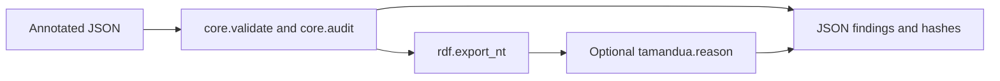
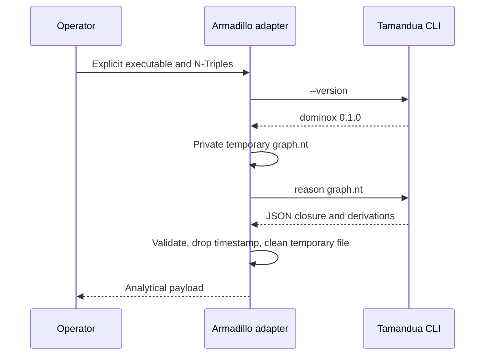
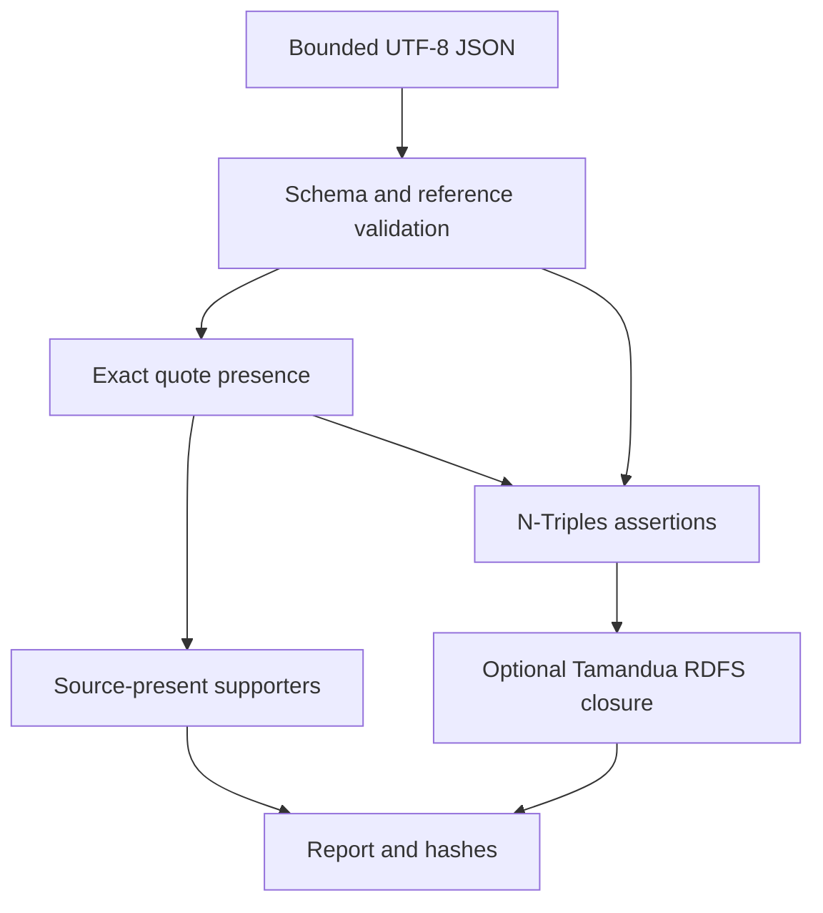
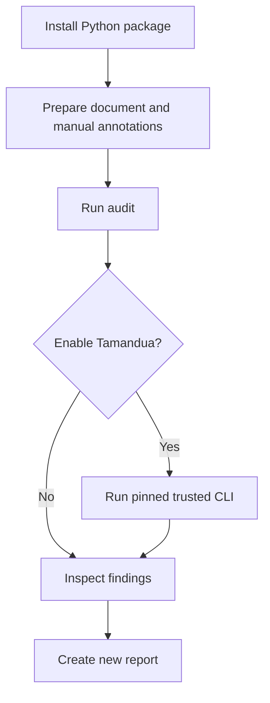
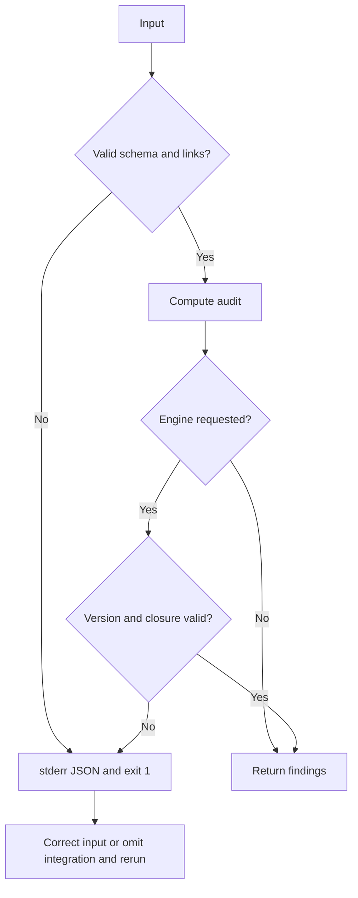
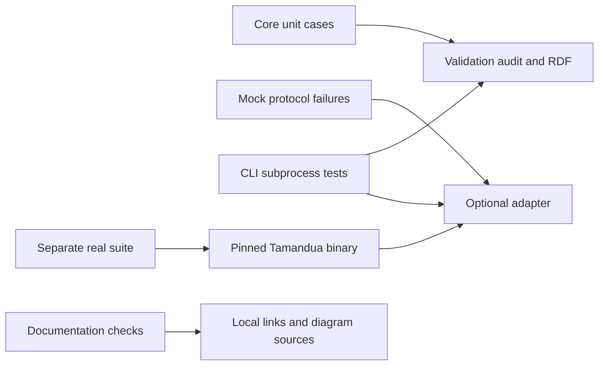

# Editable diagrams

Implemented MVP, not future proposals. Mermaid source files are editable. Rendering is not independently validated by a Mermaid CLI.

## system

[Source](system.mmd)

## integration

[Source](integration.mmd)

## data-flow

[Source](data-flow.mmd)

## workflow

[Source](workflow.mmd)

## errors

[Source](errors.mmd)

## testing

[Source](testing.mmd)

## Annotation comparison

[Editable source](comparison.mmd) shows standalone diffs and the optional actual Tamandua impact exchange. It is implemented; no scientific-entailment claim is implied.
