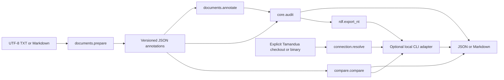
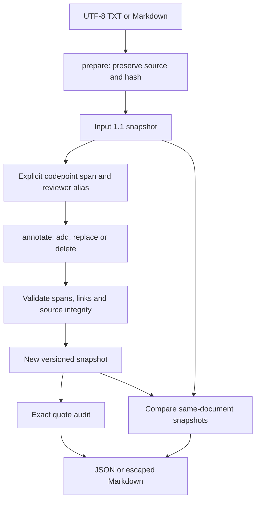
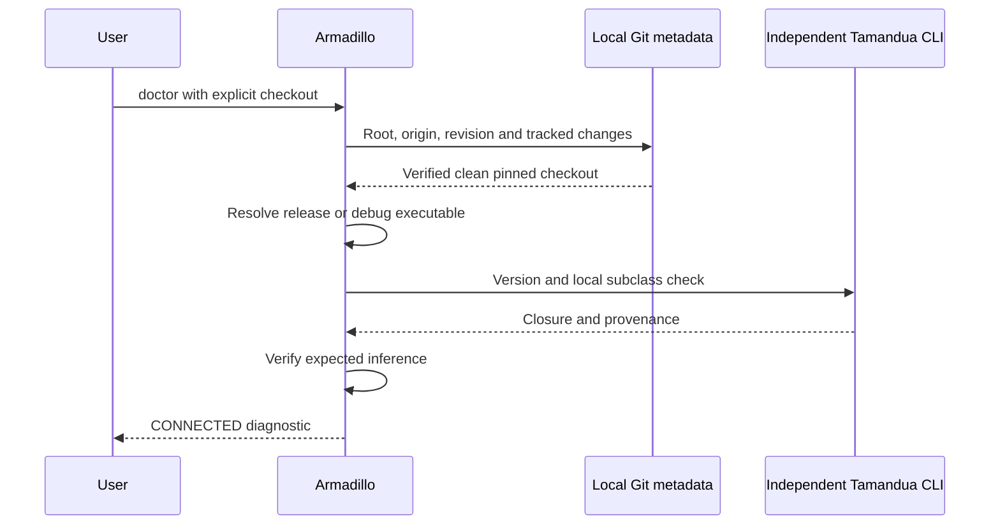
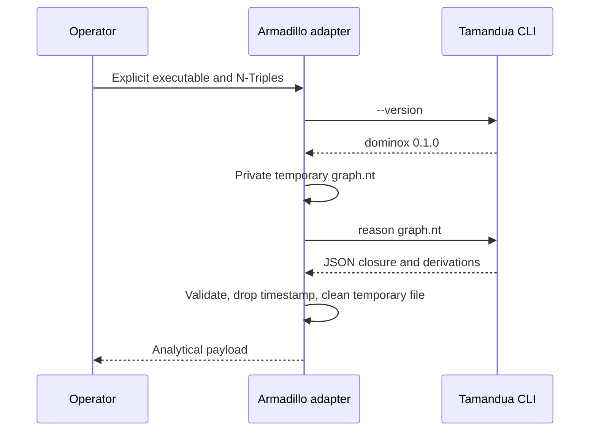
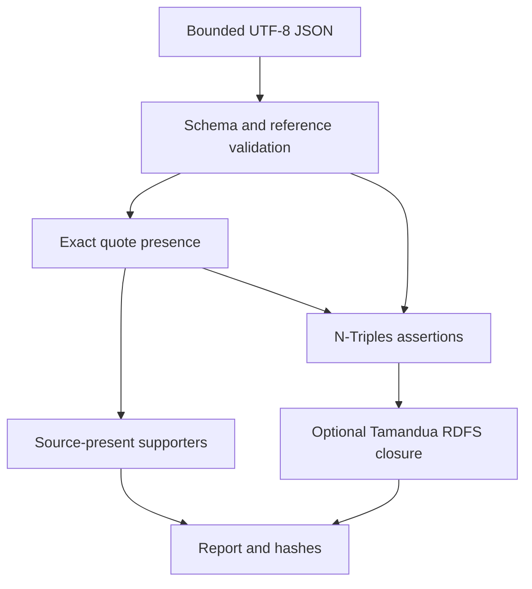
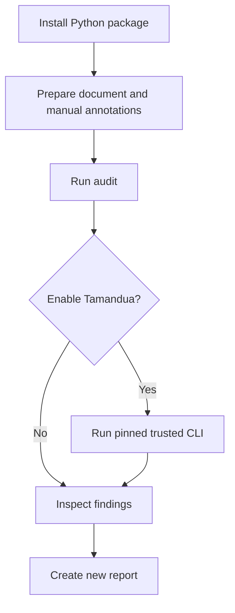
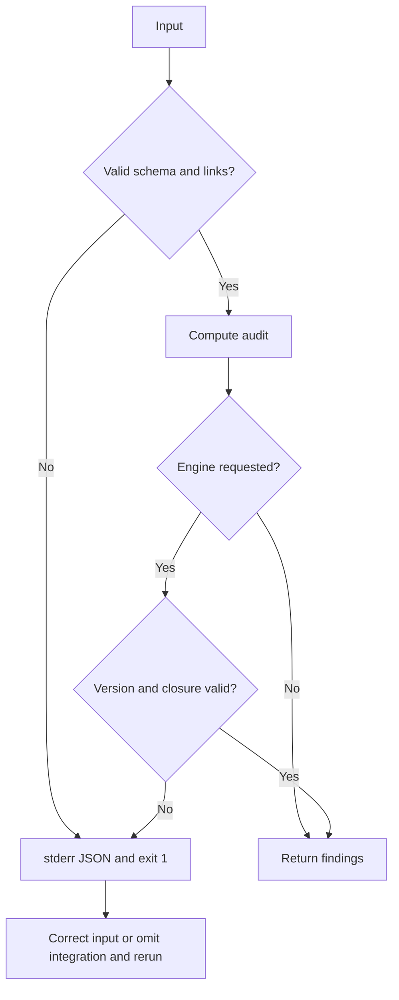
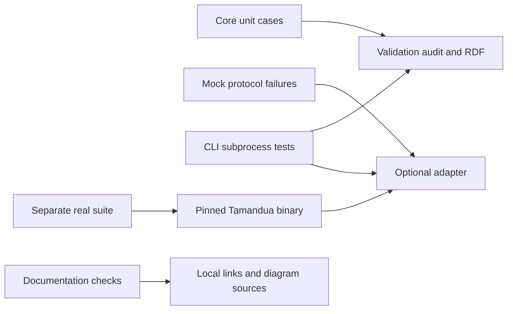
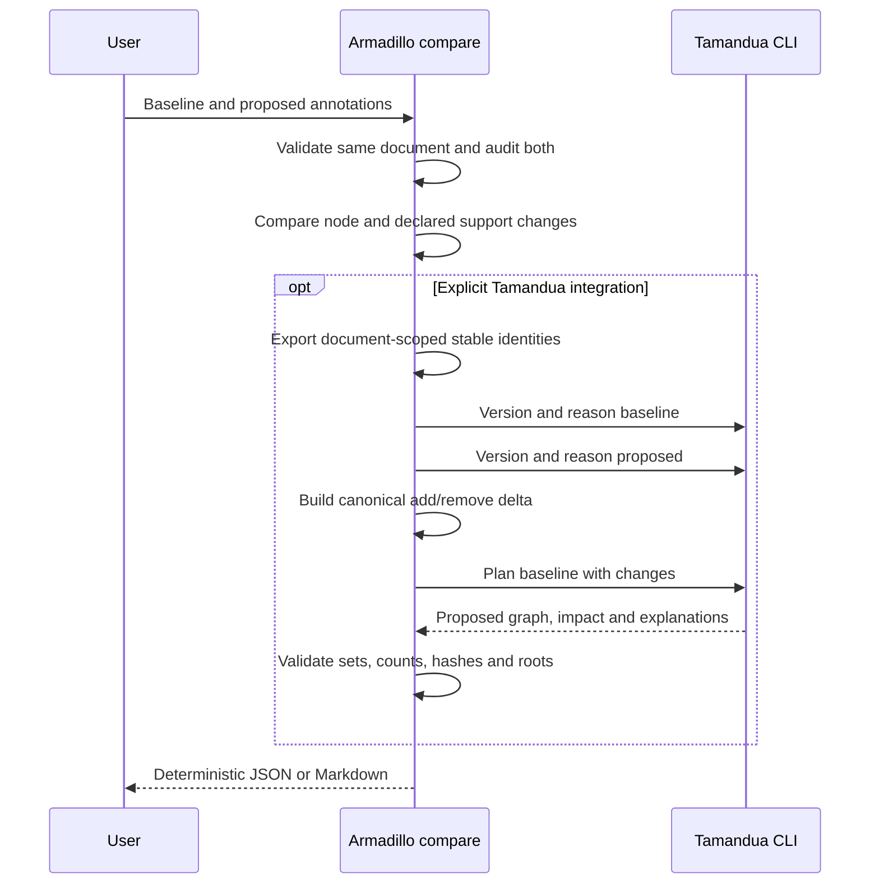

# Editable architecture and workflow diagrams

All diagrams describe implemented behavior. No scientific inference, remote service or future component is implied. Each source is editable Mermaid; all nine sources passed Mermaid syntax parsing as recorded in the latest test results. Browser rendering/layout is not claimed.

## System

[Editable source](system.mmd)

## Documents

[Editable source](documents.mmd)

## Connection

[Editable source](connection.mmd)

## Integration

[Editable source](integration.mmd)

## Data Flow

[Editable source](data-flow.mmd)

## Workflow

[Editable source](workflow.mmd)

## Errors

[Editable source](errors.mmd)

## Testing

[Editable source](testing.mmd)

## Comparison

[Editable source](comparison.mmd)

